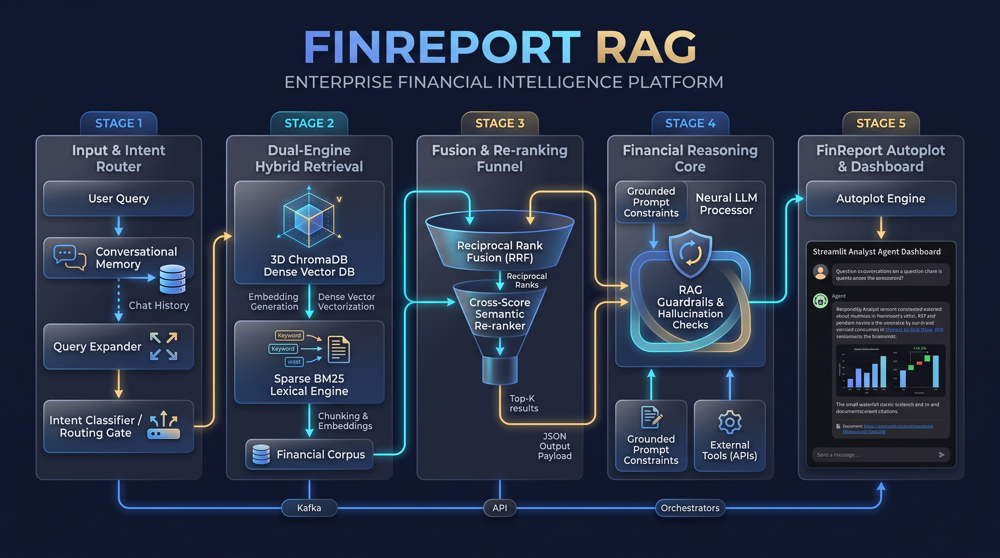

# 🚀 **FinReport RAG** - Streamlit Edition 🏦📊

[](https://www.python.org/)
[](https://streamlit.io/)
[](https://www.langchain.com/)
[](https://openai.com/)
[](https://www.trychroma.com/)
[](https://www.docker.com/)

---



## 📌 **Project Overview**

**FinReport RAG** is an enterprise-grade financial document intelligence and conversational analysis platform. Powered by **Hybrid Retrieval (Dense ChromaDB + BM25 Sparse)**, **Reciprocal Rank Fusion (RRF)**, **Cross-Encoder Semantic Re-ranking**, and an **Executive Financial Autoplot Engine**, it transforms unstructured financial reports (10-Ks, 10-Qs, annual earnings, analyst notes) into actionable executive insights with audit-grade source attribution and Bloomberg/FT-styled visual data storytelling.

Built natively for **Python 3.14+** and fully containerized with **Docker** and **Docker Compose**, FinReport RAG runs seamlessly in local development, isolated Conda environments, or production cloud containers.

---

## ✨ **Key Architectural Capabilities**

### 🔍 **Next-Gen Hybrid Retrieval & Re-ranking**
- **Dense Semantic Embeddings**: OpenAI `text-embedding-3-small` stored in persistent ChromaDB.
- **Sparse BM25 Keyword Indexing**: Rank-BM25 engine indexing exact financial terms, tickers, table row keys, and regulatory codes that dense vectors often miss.
- **Reciprocal Rank Fusion (RRF, $k=60$)**: Mathematical fusion combining dense semantic candidates and sparse lexical candidates into an unbiased, unified candidate pool.
- **Semantic Re-ranking**: Two-stage retrieval filtering out irrelevant context chunks prior to prompt assembly, drastically reducing hallucination risk and token overhead.
- **Causal Multi-Query Expansion**: Deconstructs complex executive prompts into multi-angle variations (temporal, causal drivers, and metric comparisons).

### 📊 **Executive Financial Autoplot Engine**
- **Decision Gating**: Intelligently determines when raw narrative is sufficient, when structured markdown tables are required, and when visual charts deliver superior cognitive impact.
- **Executive Color Palette**: Modern Bloomberg Terminal & Financial Times inspired color tokens (Sapphire Blue `#003366`, Amber Gold `#FFBF00`, Emerald Green `#008080`, Crimson `#D9534F`).
- **Data Storytelling Visualizations**:
  - **Growth Divergence Charts**: Direct year-over-year comparisons with automated delta percentage callouts (`+15.2%`, `-4.8%`).
  - **Waterfall Bridges**: Explaining EBITDA/revenue reconciliations and cost walk breakdowns.
  - **Executive Grouped & Area Charts**: Highlighting longitudinal metric trends with hover templates and formatted currency/percentage axes.

### 📄 **Document Ingestion & Chunking**
- **Financial-Tuned Chunking**: 550-token semantic chunks with 100-token overlaps, calibrated specifically to keep financial tables, footnotes, and accounting statements intact.
- **Batch Processing**: Supports multi-PDF uploads with automatic text extraction, metadata tagging (source doc, page numbers), and vectorization progress tracking.

### 🔭 **Observability & Monitoring (LangSmith Ready)**
- Native hooks for **LangSmith** tracing: inspect latency, token consumption, retrieval recall, and prompt iterations across all user interactions without modifying application code.

### 🐳 **Hardened Docker & Multi-Platform Deployment**
- Multi-stage build running on `python:3.14-slim`.
- Dedicated non-root user (`finrag`) with explicit permissions for persistent data storage.
- Health checks with automatic restart policies.

---

## 🖼️ **Screenshots**

### Application Home


### Processing Documents


### Sample Q&A


### Visualizations & Sources


---

## 🏗 **Tech Stack**

| Component | Technology | Version |
|---|---|---|
| **Runtime Language** | Python | 3.14+ |
| **Frontend UI** | Streamlit | ≥ 1.40.0 |
| **Visual Storytelling** | Plotly | ≥ 6.0.0 |
| **RAG Orchestration** | LangChain / LangChain-Community / LangChain-OpenAI | ≥ 0.3.0 |
| **Sparse Retrieval** | rank-bm25 | ≥ 0.2.2 |
| **Dense Vector Store** | ChromaDB | ≥ 0.6.0 |
| **Embeddings & LLMs** | OpenAI API (`text-embedding-3-small`, `gpt-4o`, `gpt-6-luna`, `o1`, `o3-mini`) | ≥ 1.50.0 |
| **Document Parsing** | pypdf | ≥ 5.0.0 |
| **Containerization** | Docker, Docker Compose | Multi-Stage Linux |

---

## 📁 **Project Structure**

```
FinReportRAG/
├── app.py                         # Main Streamlit web application & UI orchestration
├── Dockerfile                     # Multi-stage production Docker build (Python 3.14-slim, non-root)
├── docker-compose.yml             # Container orchestration (volumes, healthchecks, env mapping)
├── .dockerignore                  # Context exclusion rules for lean container builds
├── requirements.txt               # Pinned Python dependencies (modernized for 3.14+)
├── environment.yml                # Conda environment manifest (finrag_env)
├── .env.example                   # Configuration template for environment variables
├── .env                           # Local secrets & API keys (strictly git-ignored)
├── Makefile                       # Developer automation shortcuts (test, lint, docker)
├── run_app.bat                    # One-click Windows launcher (detects venv / conda / python)
├── run_app.sh                     # Linux/macOS executable launcher
├── setup.py                       # Package setup and build configuration
│
├── backend/
│   ├── app/
│   │   ├── config.py              # Centralized configuration, env parsing & LLM factory
│   │   ├── services/
│   │   │   ├── processing.py      # PDF text extraction & financial-tuned chunking (550 tokens)
│   │   │   ├── vector_db.py       # ChromaDB vector store & BM25SearchIndex (HybridRetriever)
│   │   │   ├── enhanced_rag.py    # Hybrid RAG engine (Causal query expansion, RRF, re-ranking)
│   │   │   ├── rag.py             # Baseline single-query RAG chain implementation
│   │   │   └── embeddings.py      # Embeddings caching & vectorization helpers
│   │   ├── utils/
│   │   │   └── logging_config.py  # Production rotating file & console logging setup
│   │   └── db/
│   │       └── chroma_db/         # Local persistent ChromaDB vector storage (git-ignored)
│   └── tests/                     # Pytest automated test suite (PDF, vector DB, RAG)
│
├── streamlit_app/
│   ├── config/
│   │   └── colors.py              # Executive Bloomberg / Financial Times color tokens & themes
│   └── utils/
│       ├── auto_viz.py            # Financial storytelling autoplot engine (decision gating, waterfall)
│       ├── visualizations.py      # Plotly chart renderers, formatting helpers & layout specs
│       ├── session_state.py       # Conversational memory & document state management
│       └── timing.py              # Operation telemetry & execution benchmarking
│
├── sample_data/                   # Demo financial reports (Annual Reports 2021-2023)
├── logs/                          # Persistent application runtime logs (git-ignored)
└── img/                           # Application screenshots & UI preview assets
```

---

## 🧠 **RAG Pipeline Architecture**


---

## 🚀 **Getting Started**

### **Prerequisites**
- **Python 3.14+** (or Conda / Docker Desktop)
- **OpenAI API Key** ([platform.openai.com](https://platform.openai.com/))
- *(Optional)* **LangSmith API Key** ([smith.langchain.com](https://smith.langchain.com/)) for telemetry and monitoring

---

### **Option 1: Local Installation**

#### **1️⃣ Clone the Repository**
```bash
git clone https://github.com/JairParra/FinReportRAG.git
cd FinReportRAG
```

#### **2️⃣ Create and Activate Environment**

##### **Via Conda (Recommended if using Anaconda / Miniconda):**
```bash
conda env create -f environment.yml
conda activate finrag_env
```

##### **Via Python 3.14 Virtual Environment (pip):**
```bash
# On Windows:
python -m venv venv
venv\Scripts\activate
pip install -r requirements.txt

# On macOS / Linux:
python3 -m venv venv
source venv/bin/activate
pip install -r requirements.txt
```

#### **3️⃣ Configure Environment Variables**
Copy `.env.example` to `.env`:
```bash
# Windows:
copy .env.example .env

# macOS / Linux:
cp .env.example .env
```

Edit `.env` with your OpenAI credentials:
```env
# Core OpenAI Configuration
OPENAI_API_KEY=sk-proj-your-openai-key-here
OPENAI_MODEL=gpt-6-luna
REASONING_EFFORT=medium

# Database & Logging
CHROMA_DB_PATH=backend/app/db/chroma_db
DEBUG_MODE=false
ENABLE_FILE_LOGGING=true

# (Optional) LangSmith Observability
LANGCHAIN_TRACING_V2=false
LANGCHAIN_API_KEY=lsv2_pt_your-key-here
LANGCHAIN_PROJECT=FinReport-RAG
LANGCHAIN_ENDPOINT=https://api.smith.langchain.com
```

#### **4️⃣ Launch the Application**

Using the one-click launch scripts:
```bash
# On Windows:
.\run_app.bat

# On Linux/macOS:
chmod +x run_app.sh
./run_app.sh
```

Or directly via Streamlit:
```bash
streamlit run app.py
```

The application will be live at: **`http://localhost:8501`**

---

### **Option 2: Docker Deployment (Recommended for Production)**

FinReport RAG includes a production-grade multi-stage Docker build configured with non-root security, persistent named volumes, and automated health checks.

#### **1️⃣ Quick Start with Docker Compose**
Ensure Docker Desktop is running, then run:

```bash
# Build and run container in detached mode
docker compose up -d --build
```
*(Alternatively, run `make docker-run` if Make is installed).*

#### **2️⃣ View Container Logs & Health**
```bash
# Stream real-time logs
docker compose logs -f

# Check container health status
docker compose ps
```

The app will be accessible at **`http://localhost:8501`**.

#### **3️⃣ Stop and Manage Containers**
```bash
# Stop containers while preserving ChromaDB and logs volumes
docker compose down

# Stop and wipe persistent data volumes (clean slate)
docker compose down -v
```

#### **4️⃣ Standalone Docker Run (Without Compose)**
You can also run the container directly:
```bash
# 1. Build the image
docker build -t finreport-rag:latest .

# 2. Run with environment variables and local volume mounts
docker run -d \
  --name finreport-rag-app \
  -p 8501:8501 \
  -e OPENAI_API_KEY="your-api-key" \
  -e OPENAI_MODEL="gpt-6-luna" \
  -v finrag_chroma:/app/backend/app/db/chroma_db \
  -v finrag_logs:/app/logs \
  finreport-rag:latest
```

#### **5️⃣ Changing the Host Port**
To run on a different port (e.g., `8502`), set `APP_PORT=8502` in your `.env` before running `docker compose up -d`.

---

## 💡 **How to Use FinReport RAG**

### **Step 1: Document Ingestion**
In the left sidebar:
1. **Upload PDFs**: Drag and drop custom earnings reports, 10-Ks, or prospectuses.
2. **Load Sample Data**: One-click demo loading pre-bundled financial reports (2021–2023).
3. Click **"🚀 Process Documents"** or **"🚀 Load Sample Data"**. The hybrid indexer extracts text, segments 550-token semantic chunks, builds the BM25 lexical index, and vectors embeddings into ChromaDB.

### **Step 2: Interactive Financial Analysis**
Ask strategic, quantitative, or risk-related questions:
- *"What were total revenues and net income across 2021, 2022, and 2023?"*
- *"Why did operating margins contract in FY22? Provide the primary causal drivers."*
- *"Compare R&D expenditures as a percentage of revenue over time."*
- *"What are the principal foreign exchange risk disclosures in Item 7A?"*

Each answer provides:
- Executive-level synthesis and structured bullet points.
- Transparent source attribution with exact document names and page numbers.
- Automated data tables whenever numerical metrics are retrieved.

### **Step 3: Executive Autoplot Storytelling**
When numerical comparisons or multi-period disclosures are discussed:
- The **Executive Autoplot Engine** automatically evaluates if a chart enhances executive understanding.
- Generates **Growth Divergence** bar charts with highlighted delta percentages.
- Generates **Waterfall** bridge charts showing reconciliation between start/end figures.
- Allows on-demand chart customization in the **"📊 Visualizations"** tab.

---

## 🔭 **LangChain & LangSmith Observability**

To monitor prompt latency, token costs, and evaluate retrieval relevance in LangSmith:

1. Obtain a free API key at [smith.langchain.com](https://smith.langchain.com/).
2. In your `.env` (or Docker Compose environment):
   ```env
   LANGCHAIN_TRACING_V2=true
   LANGCHAIN_API_KEY=your_langchain_api_key_here
   LANGCHAIN_PROJECT=FinReport-RAG
   ```
3. Restart the app. Every user question, query expansion, Chroma retrieval, BM25 ranking, and LLM generation will be traced live in your LangSmith dashboard.

---

## 🧪 **Testing Suite**

FinReport RAG includes unit and integration tests covering PDF processing, hybrid vector storage, and RAG chains:

```bash
# Run test suite
pytest backend/tests/ -v

# Run with verbose test logging
pytest backend/tests/ -v --tb=short --log-cli-level=INFO
```
*(Or via `make test` / `make test-verbose`).*

---

## 🛠️ **Developer Makefile Commands**

| Command | Action |
|---|---|
| `make run` | Run Streamlit locally |
| `make run-debug` | Run locally with debug logging enabled |
| `make install` | Install production dependencies from `requirements.txt` |
| `make install-dev` | Install test and linting tooling (`pytest`, `black`, `ruff`) |
| `make test` | Execute test suite |
| `make lint` | Run Ruff linter with automated fixes |
| `make format` | Reformat code using Black |
| `make docker-build`| Build the production Docker image |
| `make docker-run` | Launch Docker Compose containers in background |
| `make docker-logs` | Stream live container logs |
| `make docker-shell`| Open an interactive shell inside the running container |
| `make docker-stop` | Gracefully shut down Docker containers |
| `make docker-clean`| Stop containers and purge persistent data volumes |

---

## 🐛 **Troubleshooting & FAQs**

### **1. Docker volume permissions on Linux / WSL2**
- The container runs as non-root user `finrag` (UID `999`). All volume directories (`backend/app/db/chroma_db`, `logs`, `temp_uploads`) are pre-configured with read/write permissions. If hosting on a custom Linux mount, ensure the host directory has write permissions (`chmod -R 777 ./logs ./temp_uploads`).

### **2. Streamlit port conflicts (`8501` already in use)**
- In `.env`, set `APP_PORT=8502` (or any available port). Docker Compose maps `${APP_PORT:-8501}:8501` automatically.

### **3. Python 3.14 wheel compatibility**
- All dependencies in `requirements.txt` and `environment.yml` have been verified for Python 3.14+ compatibility. Legacy packages (`faiss-cpu`, `sentence-transformers`, `torch`) have been replaced with the native, lightweight `rank-bm25` and OpenAI Embeddings stack.

### **4. Missing `.env` file**
- Copy `.env.example` to `.env` and insert your OpenAI API key before launching. The Docker container will gracefully warn if keys are missing.

---

## 🔒 **Security & Production Best Practices**

- **Zero Secret Baking**: API keys and secrets are never baked into Docker images or committed to Git.
- **Non-Root Execution**: Docker container runs as restricted user `finrag`.
- **Data Isolation**: ChromaDB vector indices and logs reside on isolated volumes, preventing container bloat and data loss during image updates.
- **Input Sanitization**: PDF uploads are validated and stored in isolated scratch directories with session cleanup.

---

## 📜 **License & Intellectual Property**

This project is licensed under the **Creative Commons Attribution-NonCommercial 4.0 International License (CC BY-NC 4.0)**.

```
Copyright (c) 2026 Jair Parra. All rights reserved.
```

### Key Terms:
- **Attribution**: You must give appropriate credit to **Jair Parra / FinRAG**, provide a link to the license, and indicate if changes were made.
- **Non-Commercial**: You may **not** use the material, code, architectures, or prompt workflows for commercial purposes or monetized services.
- **Sharing & Adaptations**: You may freely read, study, fork, and adapt the repository for personal, educational, research, and non-commercial open-source exploration.
- For commercial licensing or enterprise inquiries, please contact the author directly.

See the full [LICENSE](file:///c:/Users/hair-/OneDrive/Desktop_remote/CODE/RAG_VECTORDBS_PROJ/FinRAG/LICENSE) file for complete legal terms.

---

## 👨‍💻 **Author & Acknowledgments**

**Jair Parra**  
- GitHub: [@JairParra](https://github.com/JairParra)

*Contributions, feedback, and feature suggestions are welcome! If you find this project valuable, please give it a ⭐ on GitHub.*
