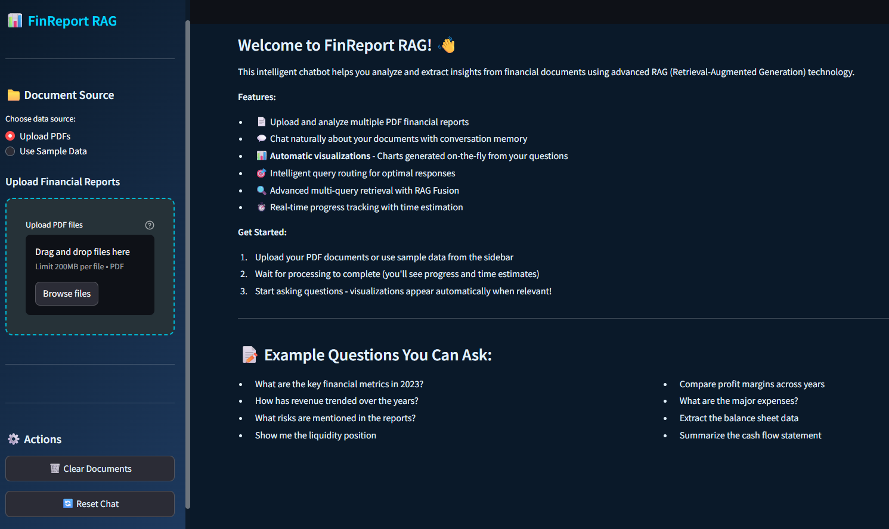
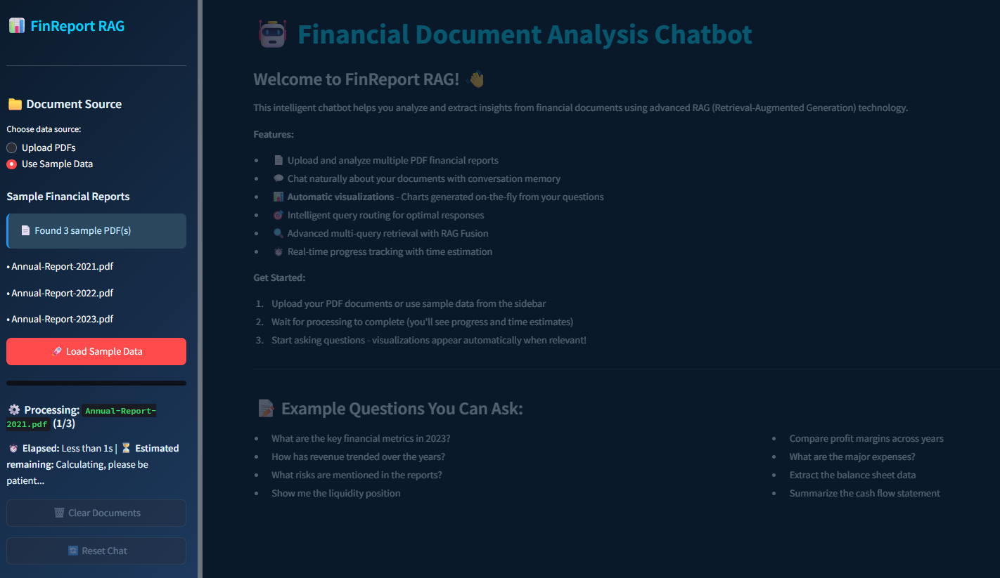
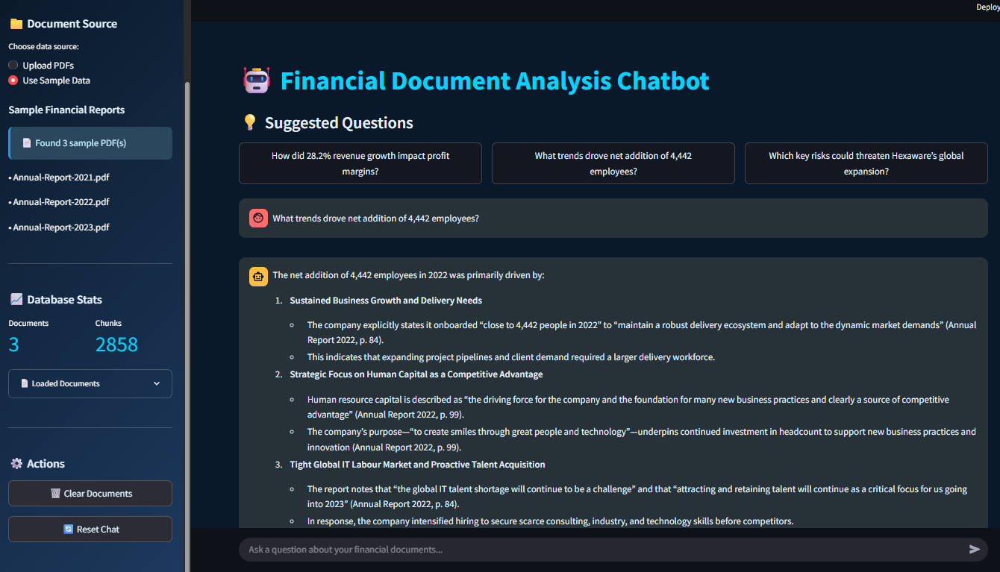
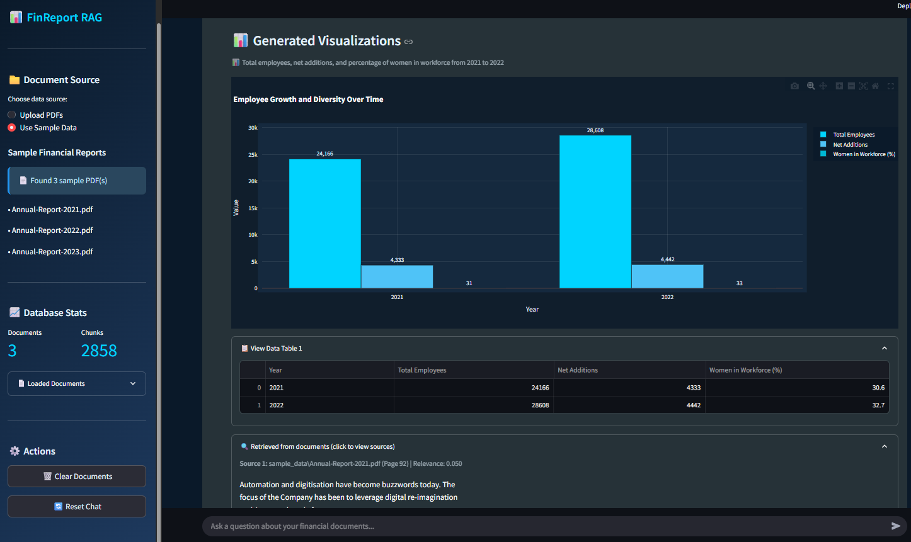

# 🚀 **FinReport RAG** - Streamlit Edition 🏦📊

[](https://streamlit.io/)
[](https://www.langchain.com/)
[](https://openai.com/)
[](https://www.docker.com/)

---

## 📌 **Project Overview**

**FinReport RAG** is an intelligent financial document analysis chatbot powered by advanced **Retrieval-Augmented Generation (RAG)** technology. Built with **Streamlit** for an intuitive user interface, **LangChain** for sophisticated document processing, and **OpenAI's GPT-4** for natural language understanding, this application enables real-time analysis and Q&A with financial documents.

### ✨ **Key Features**

🔹 **📄 Intelligent PDF Upload & Processing**: Upload multiple financial PDFs or use sample data  
🔹 **🤖 Smart Conversational AI**: Chat naturally with context-aware conversation memory  
🔹 **🔍 Advanced RAG Architecture**: Multi-query retrieval with RAG Fusion for optimal accuracy  
🔹 **🧠 Intelligent Query Routing**: Automatically determines when to use document retrieval vs. conversational context  
🔹 **📊 Dynamic Visualizations**: Generate tables and charts on-the-fly from document content  
🔹 **💾 Persistent Vector Database**: ChromaDB for efficient semantic search  
🔹 **🎨 Professional Dark Blue UI**: Custom-designed financial analyst theme  
🔹 **🐳 Docker Support**: Fully containerized for easy deployment  

---

## 🖼️ **Screenshots**

### Application Home


### Processing Documents


### Sample Q&A


### Visualizations & Sources


---

## 🏗 **Tech Stack**

| Category         | Technologies |
|-----------------|-------------|
| **Frontend**    | Streamlit, Plotly, Custom CSS |
| **AI & NLP**    | OpenAI GPT-4, LangChain, ChromaDB |
| **Vector DB**   | ChromaDB with OpenAI Embeddings |
| **Deployment**  | Docker, Docker Compose |
| **Language**    | Python 3.10 |

---

## 📁 **Project Structure**

```
FinReportRAG/
├── app.py                      # Main Streamlit application
├── Dockerfile                  # Multi-stage Docker build
├── docker-compose.yml          # Docker Compose setup
├── requirements.txt            # Python dependencies
├── environment.yml             # Conda environment
├── .env.example                # Environment variable template (safe to commit)
├── .env                        # Local secrets (NOT committed)
├── Makefile                    # Dev & Docker shortcuts
│
├── backend/
│   └── app/
│       ├── config.py           # Configuration management
│       ├── services/
│       │   ├── processing.py   # PDF processing
│       │   ├── vector_db.py    # Vector database operations
│       │   ├── rag.py          # Base RAG implementation
│       │   └── enhanced_rag.py # Enhanced RAG with intelligent routing
│       └── db/
│           └── chroma_db/      # Persistent vector database (not tracked)
│
├── streamlit_app/
│   ├── config/
│   │   └── colors.py           # Custom UI color palette
│   └── utils/
│       ├── session_state.py    # Session management
│       ├── visualizations.py   # Chart generation
│       └── auto_viz.py         # Automatic visualization extraction
│
├── rag_templates/              # Reusable RAG strategy implementations
│   ├── base_rag.py             # Baseline RAG chain
│   ├── multiquery_rag.py       # Multi-query retrieval
│   ├── hyde_rag.py             # HyDE (Hypothetical Document Embeddings)
│   ├── rag_fusion.py           # RAG Fusion with RRF re-ranking
│   ├── step_back_rag.py        # Step-back prompting
│   ├── recursive_answer_rag.py # Recursive answer refinement
│   ├── indexers/
│   │   └── multi_repr_indexing.py  # Multi-representation indexing
│   └── routers/
│       ├── logical_router.py   # Rule-based routing
│       └── semantic_router.py  # Embedding-based routing
│
├── img/                        # App screenshots
├── sample_data/                # Sample financial PDFs (not tracked)
├── logs/                       # Application logs (not tracked)
└── backend/tests/              # Test suite
```

---

## 🚀 **Getting Started**

### **Prerequisites**

- Python 3.10+
- OpenAI API Key
- (Optional) LangChain API Key for LangSmith tracing

### **Option 1: Local Installation**

#### **1️⃣ Clone the Repository**

```bash
git clone https://github.com/JairParra/FinReportRAG.git
cd FinReportRAG
```

#### **2️⃣ Create Environment**

Using Conda (Recommended):
```bash
conda env create -f environment.yml
conda activate finrag_env
```

Or using pip:
```bash
python -m venv venv
source venv/bin/activate  # On Windows: venv\Scripts\activate
pip install -r requirements.txt
```

#### **3️⃣ Set Up Environment Variables**

Copy the provided template and fill in your keys:

```bash
cp .env.example .env
```

Then edit `.env`:

```env
OPENAI_API_KEY=your_openai_api_key_here
LANGCHAIN_API_KEY=your_langchain_api_key_here
LANGCHAIN_TRACING_V2=false
LANGCHAIN_ENDPOINT=https://api.smith.langchain.com
CHROMA_DB_PATH=backend/app/db/chroma_db
```

#### **4️⃣ Run the Application**

```bash
make run
# or directly:
streamlit run app.py
```

The app will open at **`http://localhost:8501`**

---

### **Option 2: Docker Deployment**

#### **1️⃣ Build and Run with Docker Compose**

```bash
# Build the image
make docker-build

# Start the application (detached)
make docker-run
```

#### **2️⃣ Access the Application**

Open your browser to **`http://localhost:8501`**

#### **3️⃣ Useful Docker Commands**

```bash
make docker-logs     # Stream logs
make docker-restart  # Restart the container
make docker-shell    # Open a shell inside the container
make docker-stop     # Stop the application
make docker-clean    # Stop and remove all volumes (destructive)
```

#### **4️⃣ Change the Host Port**

Set `APP_PORT` in your `.env` before starting:
```env
APP_PORT=8502
```

---

## 💡 **How to Use**

### **Step 1: Load Documents**

Choose one of two options in the sidebar:

1. **Upload PDFs**: Upload your own financial reports (PDF format)
2. **Use Sample Data**: Load pre-included sample reports for demo

Click the **"🚀 Process Documents"** or **"🚀 Load Sample Data"** button.

### **Step 2: Start Chatting**

Once documents are loaded, ask questions like:

- "What are the key financial metrics in 2023?"
- "How has revenue trended over the past years?"
- "What risks are mentioned in the reports?"
- "Compare profit margins across different years"
- "Extract the balance sheet data"

### **Step 3: Generate Visualizations**

Switch to the **"📊 Visualizations"** tab to:

- View automatically extracted key metrics
- Generate custom charts by describing the data you want
- Create summary financial charts

### **Features in Action**

- **Conversation Memory**: The chatbot remembers your conversation context
- **Intelligent Routing**: Automatically decides when to search documents vs. use chat history
- **Source Citations**: Responses include page numbers and source documents
- **RAG Fusion**: Uses multiple query variations for better retrieval

---

## 🧬 **RAG Templates** (`rag_templates/`)

The `rag_templates/` folder contains standalone, reusable implementations of advanced RAG strategies that can be adapted into the main pipeline:

| Template | Description |
|---|---|
| `base_rag.py` | Baseline single-query RAG chain |
| `multiquery_rag.py` | Generates multiple query variations to improve recall |
| `hyde_rag.py` | Hypothetical Document Embeddings — generates a fake answer to retrieve better context |
| `rag_fusion.py` | Runs multiple retrievals and re-ranks with Reciprocal Rank Fusion |
| `step_back_rag.py` | Step-back prompting — abstracts to a broader question first |
| `recursive_answer_rag.py` | Iteratively refines the answer over multiple retrieval passes |
| `indexers/multi_repr_indexing.py` | Multi-representation indexing (summary + full doc) |
| `routers/logical_router.py` | Rule-based router to select retrieval strategy |
| `routers/semantic_router.py` | Embedding-based router for intent detection |

---

## 🧪 **Testing**

```bash
# Run all tests
make test

# Verbose output with logs
make test-verbose
```

This tests PDF processing, vector database creation, RAG Q&A, and vector extraction.

---

## 🛠️ **Development**

```bash
make install-dev   # Install dev dependencies (pytest, black, ruff)
make lint          # Lint with ruff (auto-fix)
make format        # Format with black
make clean         # Remove __pycache__, .pyc, etc.
make help          # Show all available targets
```

---

## 🐛 **Troubleshooting**

### **Common Issues**

1. **ModuleNotFoundError**: Make sure all dependencies are installed
   ```bash
   make install
   ```

2. **OpenAI API Error**: Verify your API key in `.env` file

3. **ChromaDB Permission Issues**: Ensure write permissions for `backend/app/db/chroma_db/`

4. **Docker Port Conflict**: If port 8501 is in use, set `APP_PORT=8502` in `.env` before running Docker Compose.

5. **`.env` file not found** (run scripts): Copy from the template:
   ```bash
   cp .env.example .env
   ```

---

## 📊 **Architecture Highlights**

### **Intelligent Query Routing**

The system intelligently decides whether to:
- Use **RAG retrieval** for document-specific queries
- Use **conversation history** for follow-up questions

### **Enhanced RAG Pipeline**

1. **Query Generation**: Creates multiple search variations
2. **Multi-Query Retrieval**: Searches with all variations
3. **Reciprocal Rank Fusion**: Combines and ranks results
4. **Context-Aware Generation**: Uses conversation history + documents

### **Optimized Prompts**

- Financial-specific terminology
- Source citation requirements
- Metric extraction formatting
- Professional tone maintenance

---

## 🔒 **Security Notes**

- Never commit `.env` — it is listed in `.gitignore`
- Use `.env.example` as a safe template for collaborators
- ChromaDB data is stored in named Docker volumes (not the image)
- The Docker container runs as a non-root user (`finrag`)

---

## 🤝 **Contributing**

Contributions are welcome! Areas for improvement:

- Additional chart types
- More RAG strategies in `rag_templates/`
- Enhanced visualization capabilities
- Multi-language support
- Export functionality

---

## 📄 **License**

This project is licensed under the **MIT License**.

---

## 👨‍💻 **Author**

**Jair Parra**  
GitHub: [@JairParra](https://github.com/JairParra)

---

## ⭐ **Like This Project?**

If you find this useful, give it a **star** ⭐ on GitHub!

---

## 📞 **Support**

For issues or questions:
- Open an issue on GitHub
- Contact via GitHub profile

---

**Happy Analyzing! 📊🚀**
